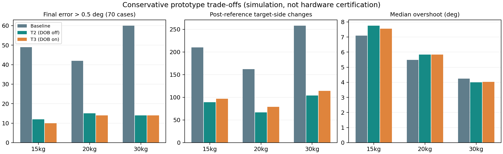

# Claude 保守优化方案：接续验证结果与最终建议

> 后续进展：用户已授权先实现隔离原型并仿真。最新实测对比见[《第一阶段优化与仿真对比》](../control_optimization_20261019/第一阶段优化_仿真对比报告.md)：包括收益、响应速度代价及仍未通过的保持/扰动场景。生产固件未改。本文保留为接续Claude任务时的分析记录。

日期：2026-10-19。对象：ADC 15kg、20kg、30kg。状态：仿真复核和方案整理已完成；候选原型尚未满足直接合入条件。**本次没有修改三份生产固件，也没有烧录硬件。**

## 1. 接续的是哪项任务

已读取 Claude 本目录对应的会话记录 `9fb5a016-e5f2-47d4-abff-cdb7f83943c9.jsonl`。它因额度用尽停在“整理定制方案与参数建议”，此前已保存 T1/T2/T3 保守原型和仿真数据，但原报告仍是更早的扩展方案。

按该会话中用户最后两次要求，本次范围是：先讨论、不改生产代码；在现有框架内提高平稳性；允许固定负载惯量比和少量 DOB；不增加电压参与的轨迹规划、电阻标定、在线惯量辨识或大规模控制器改写。旧报告第 5、7 节的扩展方案不作为本次实施建议。

**最终判断：部分优化方向有效，但不能把 T3 整包或某个惯量比作为三款通用的已验证方案。** T2 更适合作为后续分项试验的比较基准；它本身也有未解决的问题。

## 2. 本次实际完成的验证

| 项目 | 覆盖与结果 |
|---|---|
| 原结果复现 | 8 组配置 × 3 型号 × 27 负载 × 13 指令 = **8,424 个场景**；24 组运行与 Claude JSON 存档的共有指标逐项完全一致 |
| 完整慢速动作 | 基线/T3 × 三型号 × 空载、20% 重力负载且惯量比 4 × 0.5/1/2/4°/s = 48 场景；每次走完 20°再观察 2s |
| 电阻假设敏感性 | 基线/T3 × 三型号 × 两种负载 × 假设 R=1.6/2.4/3.2/4.8Ω = 48 场景；采用 400ms 大角度反复换向 |
| 大时间值及断流 | 基线/T2/T3 × 三型号 × 两种负载 × T=2000ms、T=60000ms 连续目标和 T=0 断流再恢复 = 54 场景 |
| 控制器边界 | 三型号分别执行限幅冲突、DOB→保持→运动、到位标志和 Stop 交互探针 |
| 目标工具链检查 | 隔离副本：15kg 基线正常模式、标定模式均链接成功；三个 T3 原型正常模式均因 `sqrt` 未链接失败 |
| 生产文件完整性 | 三型号共 288 个源文件/头文件/启动或链接文件 SHA-256 快照；最终复核有287个不变，15kg 的 `A_Tasks.c` 出现外部变化，详见下文；本次任务没有写入生产代码 |

闭环场景总计 **8,574 个**，另有三型号的边界探针。编译和运行均检查退出码；解析检查有限数值，不使用编译失败后遗留的可执行文件。

最终哈希复核发现，15kg 的任务/LED文件 `Application/A_Tasks.c` 与本次开始时不同；该文件不在闭环仿真的编译单元中，其余287个文件（包括各控制算法和配置）保持原哈希。目标构建阶段的隔离副本已包含当前这份任务文件。未覆盖、撤销或同步这项外部修改；也未将其调度实时性纳入本次仿真结论。

### 模型及统计的适用范围

仿真直接编译实际的配置、Servo、规划器、控制器、观测器、传感器换算及保护逻辑；硬件由桩替代。总线目标从 `A_Servo_Submit()` 进入，PWM 经过仿真输入；没有重测所有通信帧解析路径。

机械模型以 10µs 步长积分，控制周期 1ms、保护周期 10ms；包括双质量、摩擦、延迟、噪声、重力、外载和部分齿隙工况。它是相对比较工具，并非辨识过的三台实物：绕组电阻原先统一假设 3.2Ω；机械谐振与阻尼也是假设。“randload”实际是确定性多正弦负载；噪声采用固定种子。

低阻卸力桩仅清零占空比，机械方程仍保留反电势制动，未准确模拟高阻开路；也没有真实机械限位碰撞模型。因此不能用故障后的角度来定量预测实机掉落距离，更不能据此认定应取消过流卸力。目标编译不能证明最坏控制拍耗时或调度抖动已满足 1ms。

本报告的“终值出窗”指**场景结束时绝对位置误差 >0.5°**；“摆动计数”指参考结束后跨越目标两侧、幅度超过 0.3°的换侧次数，不是已经成功到位后的专门计数。“过冲”主要统计最后一条目标、参考结束后的越界量，不覆盖全程每次指令的所有过冲。

`arr` 是首次上报到位的时间，不证明随后仍在窗内，也不区分堵转收场与原目标成功完成。`settle` 是观察结束前最后一次持续留在 ±0.5°窗内的起点；原程序在更换目标时未重置其窗口记账，本次新增场景已纠正该统计。旧数据为严格复现而保持原口径，不能把旧 `settle` 当作每次目标准确的到位时长。

## 3. T1/T2/T3 到底做了什么

| 配置 | 相对上一项增加的内容 |
|---|---|
| base0 | 当前生产算法 |
| A0 | 基于反电势的净驱动电压约束；目标间隔 ≤300ms 时，规划请求时长至少为最近间隔的两倍 |
| T1 | A0 + 位置锚点 200ms 不移动才允许进入 HOLD；到位上报仍可提前 |
| T2 | T1 + 位置反馈增补电机 `kv` 对应项；固定负载惯量比 2，参与观测器与位置/积分带宽调整 |
| T3 | T2 + 30rad/s、最大 30% 标定电压的 DOB；仅运动中、非粘住且参考加速度对应电压 ≤100mV 时更新 |

这里惯量比定义为 **J_load/J_motor**，取 2 代表总惯量约为原电机的 3 倍；不是总惯量 2 倍。T2/T3 明确不放大加速度前馈，未按惯量修改规划器 A/D，未关闭原有 150ms 最短运动时间，保持附加阻尼也未开启。

这些 `CX_*` 是仿真开关，目前并不是已接入 Flash/SRAM 参数表的生产配置。无需为讨论本方案新增持久化格式；后续第一阶段可以采用编译期常量，避免顺带增加热修改与重初始化的复杂度。

## 4. 复现后的主要结果

以下每格顺序均为 **15kg / 20kg / 30kg**。每型号带载点到点子集为 14 类负载 × 5 类指令，共 70 场景。

| 指标 | 基线 | T1 | T2 | T3 |
|---|---|---|---|---|
| 终值出窗场景 /70 | 49 / 42 / 60 | 13 / 16 / 20 | 12 / 15 / 14 | 10 / 14 / 14 |
| 摆动计数合计 | 210 / 162 / 258 | 204 / 230 / 283 | 89 / 67 / 104 | 97 / 79 / 114 |
| 过冲中位数，° | 7.09 / 5.49 / 4.24 | 7.47 / 5.81 / 4.24 | 7.75 / 5.83 / 4.00 | 7.55 / 5.83 / 4.04 |
| 过冲 P90，° | 17.32 / 18.20 / 8.55 | 18.74 / 13.80 / 8.82 | 18.63 / 13.79 / 9.03 | 19.72 / 14.25 / 9.38 |
| 最大过冲，° | 44.64 / 54.27 / 67.56 | 59.30 / 46.31 / 21.80 | 68.86 / 49.93 / 20.31 | 63.05 / 39.89 / 22.10 |
| 全部 351 场景保护 fault 事件 | 12 / 14 / 2 | 0 / 0 / 0 | 0 / 0 / 0 | 0 / 0 / 0 |
| 全部 351 场景堵转事件 | 1 / 0 / 1 | 0 / 3 / 1 | 1 / 3 / 2 | 1 / 3 / 2 |



可以确认：延迟进入 HOLD 对终值误差有明显收益；T2 的反馈/惯量调整进一步减少换侧摆动。但延迟 HOLD 并没有普遍减少摆动；T2/T3 也没有普遍减少过冲，15kg 的极端过冲反而可能增加。保护 fault 变少同时出现更多堵转，也不能合并成“异常已消除”。

DOB 并非全面改善：T3 相对 T2 的三款摆动计数全部增加，过冲 P90 也全部增加；模型失配子集的终值出窗从 T2 的 5/3/2 变为 T3 的 0/2/5。变化负载下最大参考跟踪误差从 3.39/1.79/3.28°降为 2.07/1.29/2.32°，但对应停顿计数从 36/24/36 变为 49/23/50。它对一部分扰动有效，同时会损害另一部分表现。

### 4.1 惯量参数取错有何影响

保持 T3 其余参数不变，仅修改固定惯量比：

| 固定 J_load/J_motor | 终值出窗 /70，15/20/30kg | 摆动计数，15/20/30kg |
|---|---|---|
| 1 | 8 / 13 / 9 | 121 / 151 / 139 |
| 2 | 10 / 14 / 14 | 97 / 79 / 114 |
| 3 | 11 / 15 / 19 | 89 / 60 / 117 |
| 4 | 15 / 16 / 17 | 73 / 56 / 117 |

惯量取大可降低部分摆动，却可能留下更多终值误差。不存在本批测试支持的“宁大勿小”或“三款统一固定 2 最优”。J=1 的终值误差计数较好，但摆动更多，也不能反过来宣布它是通用最优值。

### 4.2 完整慢速动作没有普遍变平滑

20°完整动作 +2s 观察，表中为停顿计数“基线→T3”：

| 型号/负载 | 0.5°/s | 1°/s | 2°/s | 4°/s |
|---|---|---|---|---|
| 15kg 空载 | 73→57 | 40→27 | 7→5 | 1→1 |
| 20kg 空载 | 77→98 | 18→30 | 3→4 | 0→0 |
| 30kg 空载 | 31→33 | 8→0 | 2→0 | 0→0 |
| 15kg 重力20%、惯量4 | 7→3 | 2→0 | 0→2 | 0→2 |
| 20kg 重力20%、惯量4 | 0→5 | 0→0 | 0→0 | 0→0 |
| 30kg 重力20%、惯量4 | 33→4 | 1→6 | 1→1 | 0→2 |

慢速停顿按实际速度低于请求速度 5%、持续 20ms 统计。0.5/1°/s 原本需要 40/20s，旧 runner 固定只跑 12s，并未覆盖完整动作。本次已补足，旧短窗口计数不能与本表直接比较。静摩擦、速度噪声与量化导致的低速粘滑仍然存在；本方案不追加抖动注入来追求某个仿真计数。

### 4.3 “零过流”依赖模型假设

将模型假设电阻改为 1.6Ω，在惯量比 8、400ms 换向工况，基线和 T3 的三款均有 3 次 fault。15kg 的重力40%、惯量6工况中，基线为 1 次，T3 为 2 次。

这不是要求用户增加电阻标定，而是说明：`|u-kv*v_hat|≤Ucal` 只能表示限制净驱动电压；没有电阻、电感和真实电流闭环信息，不能保证任意电机的绝对电流不超限。原先 3.2Ω 模型中的零 fault 结果确实可复现，但“不会过流”的推广不成立，现有电流测量、限流、过流/过温保护应继续保留。

### 4.4 T 较大及断流后的结果

新增 100ms 一帧、每帧约 1°，每帧 T=2000ms 或 T=60000ms 的连续输入。最后一帧在 4s，分别观察至 8s、66s。没有出现数值非有限、故障或堵转；T=60000ms 各组终值均落在 ±0.5°内，最后一帧到到位上报约 60.02s。

但 T=2000ms、30kg、重力20%且惯量4时：基线终值 -0.06°，T2 +0.05°，**T3 -1.08°**，T3 仍曾在最后一帧后 2020ms 上报到位。这是“上报到位不等于长期保持精度”的明确反例，200ms 静止判据不足以消除所有保持偏移。

T=0 流中断 1s 再恢复，T3 的三款带载终值在 ±0.5°内；基线 20kg 为 -0.71°。恢复期间的最大参考误差仍有数度，不能宣称断流后完全无瞬态。大 T 本身也意味着响应慢；其期望时间语义应保留，不能用提高连续性作为理由无条件改写用户的时间请求。

## 5. 补查出的真实候选缺陷与处理原则

下面的问题位于 **Claude 的仿真候选副本**，不应误报成现有生产固件已经新增的缺陷。证据为 `continuation_unit.c` 和 `continued_validation/logs/unit_15.txt` 等；探针 PASS 表示反例成功复现，不表示修复通过。

### P1：净驱动电压约束的空交集可突破硬限幅

位置：候选 `C_Pos_Ctrl.c` 217–223 行。

代码将保护硬区间 `[-L,L]` 与 `[emf-W,emf+W]` 求交，区间冲突时取 `(lo+hi)/2`。该点可能落在硬区间以外。接口输入 L=100mV、外部拖动对应约空载速度 1.1 倍时，三款实际返回 **432/433/433mV**；输入速度没有超过观测器的 1.25 倍空载速度边界。

后面的占空比换算只夹到硬件满量程，没有重新按保护给定的小上限夹紧，不能指望下游自动补救。这是直接的限幅不变量破坏；探针为控制器接口边界测试，并非声称这组参数在普通空载命令中必然出现。

**建议：**硬约束具有最高优先级。先构造硬区间；软约束有交集才缩小它。若软区间完全在右侧，选择硬区间右端；完全在左侧，选择左端，并记约束不可同时满足。最终输出再次满足 `abs(u)≤L`，所有积分/抗饱和判断使用最终实际输出。不要用平均区间、关闭保护或临时放宽 L 来消除冲突。该规则有明确数学不变量，不依赖型号或故障阈值；尚未在本次生产代码中实现和回归。

### P1：DOB 转入 HOLD 直接并积分，破坏后续状态预算

位置：候选 `C_Pos_Ctrl.c` 183、192–194、206 行。

`integral += dob; dob=0` 能在当拍保留部分合力，却绕过原来的半电压积分预算。通过有效的 MOVE 更新、再 SETTLE/HOLD 的输入序列，15kg 和 30kg 的保持积分分别达到 **5459mV、5438mV**，预算为 3835mV；下一次运动被积分函数夹到 3835mV，保持输出分别从 **5459→3835mV、5439→3835mV**。同一序列中 20kg 为 3814mV，未超预算，不能把这次具体反例泛化成三款都超限。

**建议：**第一阶段关闭 DOB。后续若保留，扰动补偿作为单独的有界负载偏置，在所有状态通过同一输出求和点生效；状态切换时冻结或恢复它的更新，不通过“清零一项、塞入另一项”转移状态。积分与偏置共用可用输出预算，抗饱和使用最终限幅结果，坐标重置/卸力恢复时统一处理初始化。固定惯量失配不能由 DOB 无条件吞掉。

直接在并入后增加一次积分 clamp 会把阶跃提前到进入 HOLD，当作修复仍不合格；单纯放大积分限额也会改变原有抗饱和能力。如果保护上限突然降低，本来就无法同时保持原输出并遵守新上限，必须优先保护，并让状态跟随真实可施加输出。以上是后续设计约束，尚未完成相应实现验证。

### P1：到位上报与“当前已经使用保持律”混成一个 API

位置：候选 `C_Pos_Ctrl.c` 137、164–183 行；`A_Servo.c` 643–650 行。

新增 `reached` 后，`C_PosCtrl_Reached()` 在 SETTLE 就可能返回真。原 `A_Servo_Stop()` 用它判断已经 HOLD，因而跳过实测位置重锚。三款接口探针均在第169拍复现：参考为13595厘度，实测分别为13581/13584/13581厘度；调用 Stop 后参考仍是13595。偏差本例只有 0.11～0.14°，但证明停止分支语义被改变，不能靠偏差小就忽略。

另一条新运动中，状态已为 MOVE，`Reached()` 仍返回 1；因为该标志仅在 MOVE→SETTLE 清除。Servo 外层有 `ref.done` 门控，所以这不等于“外部一定在运动中错误上报到位”，但内部 API 语义已不可靠。

**建议：**分开“当前已进入 HOLD”查询和“本条指令达到过上报条件”事件。Stop 使用当前控制状态判断；每条新运动及重同步明确清理本条指令的资格/事件；上层到位查询采用约定语义。无需复制新的状态机，只需让接口各自回答一个明确问题。必须覆盖 Stop、暂停/继续、配置重置、卸力恢复和到位后再次下发目标的所有调用点。

### P2：主机可运行不等于目标工程可链接

三款原型保留了未启用的 `CX_HOLD_ZETA` 浮点开方分支。主机命令用了 `-lm`，目标工程现有链接选项没有它；即使该开关取0，因其是可变全局量，仍产生对 `sqrt` 的引用。三个 T3 隔离目标构建均在此失败；15kg 原版对照构建正常。

本次保守方案不选额外 HOLD 阻尼，应在后续实现时移除未选的实验路径或使用编译期裁剪，避免为未使用功能引入浮点库。不要直接把主机试验文件复制进正式工程。此次失败后没有声称标定模式也已验证，因为流程在正常模式链接处已停止。

## 6. 适合本次需求的落地顺序

### 第一阶段：小范围修改并逐项验收，DOB 关闭

1. **先固定接口和硬限幅约束。** 保持保护层权威、实际输出回馈观测器和抗饱和；保留到位事件与控制状态的独立语义。这些属于新增优化的前置条件，不是绕过保护的补丁。
2. **试验更可靠的 HOLD 进入条件。** 200ms 是已有证据的起始试验值，并非所有型号最终值。保留位置锚点判据，重新确认是否允许“已上报到位但还在 SETTLE”。暂不重写 HOLD 控制律；若验收仍出现 T3 长时间指令那样的漂移，就不能宣布保持精度达标。
3. **分开评估位置反馈修正与固定惯量调整。** T2 是组合测试，不能从整包收益认定各子项都独立有效。惯量参数先作为固定配置，仅用于观测器和带宽收敛，不放大加速度前馈。保留 J=0 的原算法对照，比较 J=1/2/3/4，按真实负载范围选择，不能强行要求精确惯量辨识。
4. **连续目标时间策略单独验收。** 原型 `max(T,2×interval)` 对200ms目标流有帮助，但会修改部分显式 T 的行为。`move_age` 记录的是上次实际规划，不总是上次接收时间；高频合并、重复帧、暂停/继续等边界尚无充分验证。若实现，应在指令入口维护唯一的流间隔/失效状态；超时、停止、模式切换、暂停按同一规则失效。先限定适用输入和时间语义，不通过多个调用点临时改全局最短时间来维持连续。
5. **净驱动电压约束作为可选项。** 必须先解决空交集。它会削弱部分反向制动力，带载减速距离可能增加；保留原有限流和故障处理，分别比较开启/关闭，不能作为电流保护替代物。

不新增电压轨迹规划、电阻标定、在线惯量辨识、低速抖动或新的保持态大框架。已知固定大惯量场景若需要更小过冲，可以使用现有 A/D 配置降低运动强度，但不将它包装成对任意变化负载自动适配的能力。

### 第二阶段：仅在第一阶段仍有扰动问题时评估 DOB

30rad/s、30%Ucal、参考惯性电压门控100mV只是 **本次跑过的试验配置**，不是推荐量产默认值。初始保持关闭；完成独立偏置预算、切换连续性和重置规则后，再对其开启/关闭做相同工况对比。只有变化负载收益成立，且没有增加到位漂移、往返摆动、低速停顿或保护冲突时，才值得启用。

### 验收条件

| 维度 | 必须能确认的事实 |
|---|---|
| 输出约束 | 正负速度、保护限幅下降、软区间无交集时始终满足最终硬限幅；所有抗饱和基于同一个最终输出 |
| 状态交接 | MOVE↔SETTLE↔HOLD、新目标、Stop、暂停/恢复、卸力/恢复不会遗留旧到位资格或无故清掉托举力；允许保护约束导致的必要变化 |
| 精度 | 区分首次入窗、到位事件、持续保持和故障收场；既看规定窗口内能否到位，也继续保持至少10s检查漂移 |
| 平稳性 | 各款空载和工作负载均比较过冲、摆动、速度纹波、停顿及输出变化；不以单一总分掩盖某型号退化 |
| 命令 | T=0、短T、2000/60000ms，重复帧、密集合并、抖动、断流、反向以及暂停/继续；显式T语义与协议说明一致 |
| 参数与工程 | 若将来支持热修改，统一在控制拍边界应用并重算相关系数，避免只改一份模型；正式常量配置下三款正常/标定模式从源构建，并测实机最坏控制拍耗时 |

“静态负载小于额定扭矩”不能单独保证高速换向能力：惯性力矩、摩擦、重力与制动力需求同时存在。没有负载边界和实物测量，无法承诺任意负载、任意命令都保持精度且完全顺滑。本批证据支持渐进优化，不支持原型已经达到该承诺。

## 7. 证据与重跑

- `continue_validation.py`：冻结候选、复现8,424场景、慢速/电阻敏感性、三型号边界探针、生产源码哈希核对。
- `continuation_unit.c`：直接通过控制器 Init/Update 和 Servo 公共命令构造边界序列；读取内部状态只用于诊断，没有直接伪造内部积分来制造反例。
- `finish_validation.py`：统计、54个长时间/断流场景、图表及目标构建；目标构建只操作 `continued_validation/target_sources/`。
- `continued_validation/matrix.json`、`summary.json`、`archive_comparison.json`：复现数据与汇总。
- `continued_validation/extra.json`、`long_commands.json`、`logs/unit_*.txt`：新增场景和反例。
- `continued_validation/target_results.json`：目标对照成功、候选失败的完整原因。
- `continued_validation/production_hashes.json`、`source_changes_during_run.json`：本次开始时的源文件快照及最终差异清单，保留15kg任务文件外部变化的记录。

在 `C:\Users\Admin\Desktop\duoji` 下依次运行：

```powershell
& 'D:\SoftWare\anaconda3\python.exe' -X utf8 -B tests/control_chain_review_20261019/continue_validation.py
& 'D:\SoftWare\anaconda3\python.exe' -X utf8 -B tests/control_chain_review_20261019/finish_validation.py
```

本次完成的是 Claude 最后要求的保守优化验证与方案整理；未重新执行 Flash 掉电保存、SRAM 热修改、恢复出厂等另一组测试，不能将本报告当作那些路径新增修复已通过的证明。
