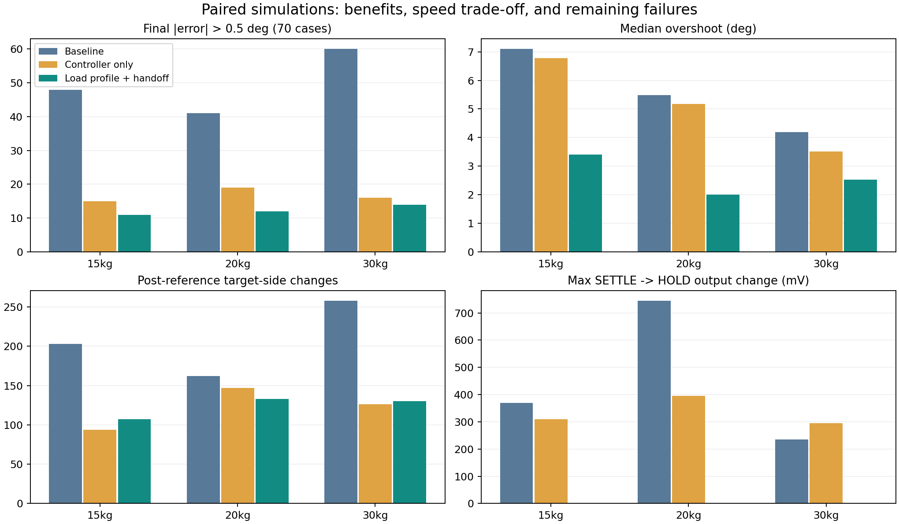
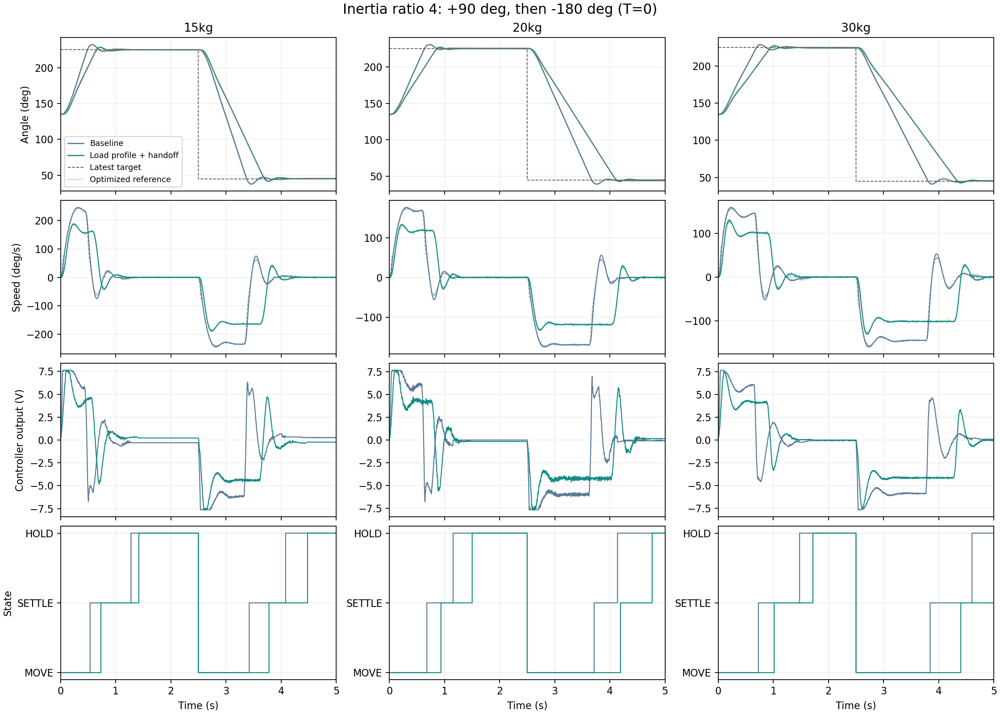
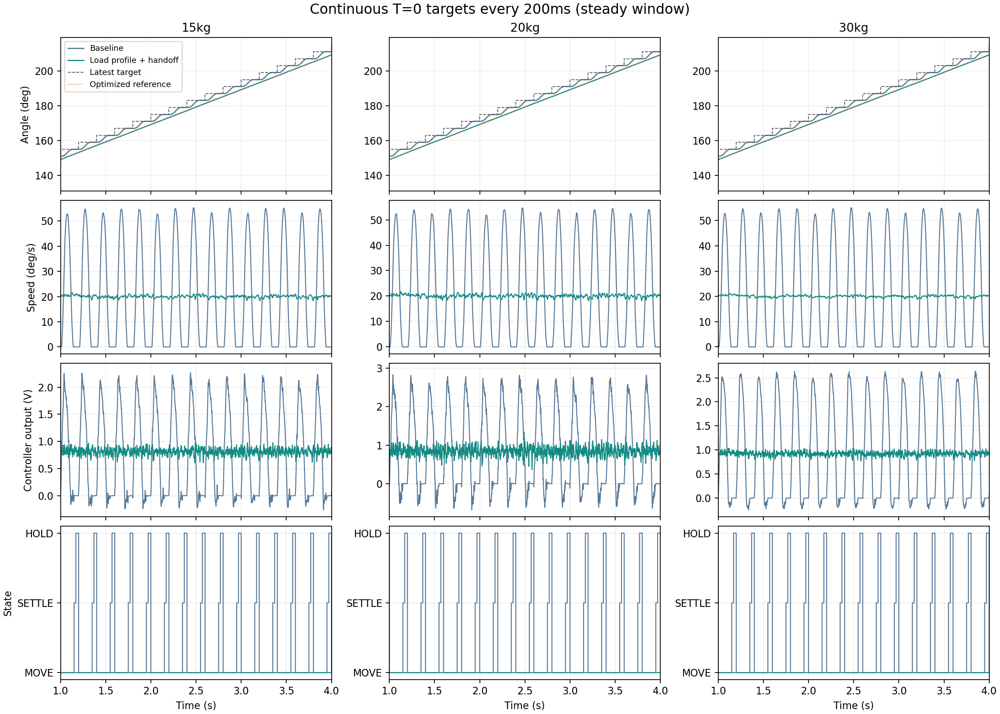
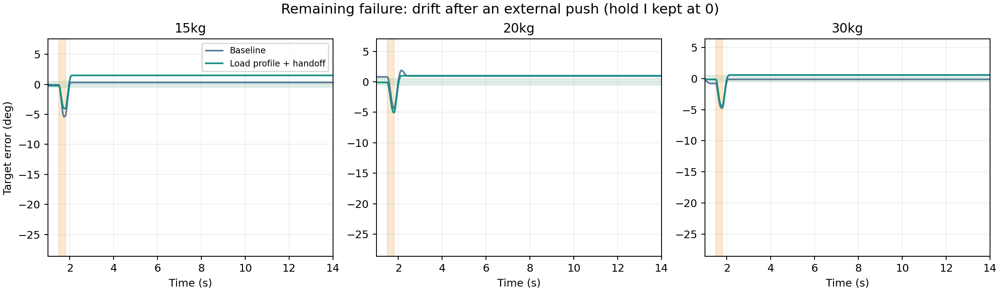

# ADC 15/20/30kg 第一阶段优化与仿真对比

日期：2026-10-19。**完成隔离原型与仿真，未修改或烧录生产固件。** 本次只讨论控制链路，未重测 Flash/SRAM/出厂恢复。

本轮有明确收益：到位残差和部分往返摆动减少，T=0连续目标的周期性停顿减轻，收尾→保持的控制律交接更连续。但外力撤除后的保持偏差、持续变化负载和卸力恢复仍有失败工况，不能直接认定整套控制已全面达标。

## 1. 实现了哪些改动

| 模块 | 本轮原型行为 |
|---|---|
| 到位接口 | 保留 `C_PosCtrl_Reached()` 的“当前HOLD”语义供Stop使用，新增本条指令到位资格查询；新运动清资格，零位移新目标也能正确完成 |
| 收尾捕获 | 保留20ms位置/速度资格条件，另以200ms位置锚点稳定作为进入保持律的条件 |
| 状态交接 | 50ms内混合已有SETTLE/HOLD两种输出及积分更新率，涵盖HOLD短路制动规则；只使用原来的一个积分器；条件撤销时权重逐步退回 |
| 位置反馈 | 对位置修正速度增补电机kv对应电压项，MOVE/SETTLE仍各用原有死区 |
| 固定惯量比 | J_load/J_motor=1作为试验值，仅用于观测器模型及位置/积分带宽收敛，不放大加速度前馈 |
| 连续T=0 | 以真正接受目标的间隔统计；连续数次同向且间隔匹配才延长规划展望；暂停、Stop、重同步、显式T、超时会失效；不临时修改全局最短运动时间 |
| 带载运动配置 | V上限取原值70%，A/D及相应J取25%。这是明确降低运动强度的试验配置，独立于控制算法收益 |
| 输出与保护 | 保留原硬限幅、积分抗饱和、电流与故障处理。单测也验证了修正后的可选软限幅，但最终候选关闭该项 |

**本轮未加入DOB、在线惯量辨识、电压轨迹规划、电阻标定、抖动注入或新的保持积分器。保持I最终仍为原默认0；另测了现有保持I参数，但未直接改默认值。**

## 2. 怎样区分算法收益与减速收益

| 名称 | 数据键 | 设置 |
|---|---|---|
| 原版 | baseline | 冻结的当前生产算法、当前默认运动参数 |
| 仅控制改进 | inertia1 | 200ms捕获、反馈修正、固定惯量比1；V/A/D不变，无50ms混合 |
| 带载配置、未混合 | optimized | 加入V70%、A/D25%和连续T=0策略；无50ms混合 |
| 最终仿真候选 | handoff | 上一项再加50ms收尾→保持混合 |

带载配置不是“免费提速又更稳”。原型中的V/A/D缩放是对照试验用的固定构建选项；若后续合入，应通过现有运动参数表达清楚实际限值、核对整数单位舍入和读回语义，不能直接把试验隐藏比例复制进参数接口。其余控制改动也还需要实机确认。

## 3. 相同主矩阵对比

每型号27负载×13指令=351条场景记录；下面位置统计取14负载×5点到点指令=70场景。每格顺序均为 **15kg / 20kg / 30kg**。

| 指标 | 原版 | 仅控制改进 | 最终候选 |
|---|---|---|---|
| 最终绝对误差>0.5°，场景/70 | 48 / 41 / 60 | 15 / 19 / 16 | 11 / 12 / 14 |
| 参考结束后往返换侧总次数 | 203 / 162 / 258 | 94 / 147 / 126 | 107 / 133 / 130 |
| 过冲中位数，° | 7.09 / 5.49 / 4.19 | 6.78 / 5.17 / 3.51 | 3.41 / 2.01 / 2.53 |
| 过冲P90，° | 18.00 / 14.64 / 7.70 | 17.49 / 17.44 / 7.13 | 8.06 / 6.21 / 5.81 |
| 全351场景fault事件 | 16 / 15 / 3 | 19 / 14 / 4 | 0 / 0 / 0 |
| 全351场景堵转事件 | 3 / 3 / 2 | 4 / 3 / 4 | 1 / 3 / 1 |
| SETTLE→HOLD最大输出变化，mV | 369 / 745 / 235 | 310 / 395 / 295 | 0 / 0 / 0 |
| 全351场景硬限幅违反拍数 | 0 / 0 / 0 | 0 / 0 / 0 | 0 / 0 / 0 |

最后一行前的切换指标不是因为候选从未进入HOLD：70场景中原版有 94 / 100 / 67 次SETTLE→HOLD，最终候选有 76 / 72 / 60 次；最终候选这些切换的相邻拍输出差均为0mV。这里测量的是控制器请求输出，母线和占空比量化仍可能改变实际施加电压。它只描述这一类状态交接，不代表所有命令切换、保护动作或每个控制拍都无阶跃。

全程所有状态切换中的最大输出变化仍为 8419 / 3496 / 3210mV，不能将局部平滑结论推广到整个控制层。

仅控制改进也有退化：15kg/30kg的fault事件比原版多；因此不建议把固定惯量比1和反馈修正视为在原运动强度下已经全面验证通过。最终候选的零fault仅适用于这套名义主矩阵；扩展卸力和电阻假设试验仍会触发保护。



## 4. 大角度运动：精度、过冲和到位时间一起看

惯量比4，先+90°、再反向180°，T=0；下表取最后一条指令。到位时间为首次事件上报，并非持续保持合格。

| 型号 | 过冲 原→后，° | 最终误差 原→后，° | 到位事件 原→后，ms |
|---|---|---|---|
| 15kg | 7.14→3.12 | +0.58→+0.24 | 1581→1688 |
| 20kg | 5.49→1.78 | -0.79→+0.11 | 1637→2040 |
| 30kg | 3.89→2.26 | +0.69→+0.13 | 2104→2333 |

此处更小过冲伴随部分动作变慢。带载配置没有普遍提高运动速度。图中同时给出目标、候选规划参考、实际位置、实际/观测速度、控制输出和状态；底层CSV还记录了前馈、反馈、积分、起转补偿、实际施加电压和本拍限幅。



重力20%、惯量比4、每400ms反向的结果：

| 型号 | 过冲 原→后，° | 最终误差 原→后，° |
|---|---|---|
| 15kg | 9.29→3.60 | +0.27→+0.21 |
| 20kg | 7.30→2.02 | -0.06→+0.05 |
| 30kg | 4.15→2.47 | +0.64→+0.11 |

## 5. 连续目标：平顺度改善，同时增加跟随滞后

空载、每200ms增加4°、T=0，统计1.0～3.9s稳态区间。速度纹波定义为(最大速度−最小速度)/平均速度。

| 型号 | 最低/平均速度 原→后 | 速度纹波 原→后 | 平均相对最新命令滞后 原→后，° | 最后一帧到到位 原→后，ms |
|---|---|---|---|---|
| 15kg | 0.00→0.92 | 2.71→0.15 | 1.55→3.85 | 169→419 |
| 20kg | 0.00→0.91 | 2.68→0.16 | 1.55→3.85 | 169→421 |
| 30kg | 0.00→0.95 | 2.70→0.11 | 1.55→3.86 | 169→421 |

原版稳态速度会降到0，候选大部分时间维持前进。但这是一种用展望时间换连续性的策略，不是预测未来目标；突停时仍需走完当前展望。仅用于已确认的T=0目标流，显式T不使用这项展望替换。



## 6. T较大、暂停、停止与低速

扩展场景在动作结束后继续观察约10s以上。重力20%、惯量4时：

| 场景 | 原版最终误差15/20/30，° | 候选最终误差15/20/30，° |
|---|---|---|
| ext_long2 | -0.13 / -0.07 / -0.06 | -0.12 / -0.08 / -0.03 |
| ext_long60 | -0.18 / -0.04 / -0.04 | -0.25 / -0.09 / -0.07 |
| ext_gap | 0.28 / -0.71 / 0.30 | 0.27 / -0.57 / 0.28 |
| ext_pause | -0.51 / 0.30 / -0.65 | -0.19 / -0.05 / -0.10 |
| ext_stop | -0.68 / 0.77 / -0.77 | -0.15 / 0.31 / 0.01 |

`ext_long2/60`分别为每100ms更新目标、每条T=2000/60000ms；`ext_gap`为T=0目标流中断1s后恢复；`ext_pause`为150ms暂停、650ms继续；`ext_stop`为150ms就地Stop，误差相对Stop选择的保持点。Stop的到位标志按业务直接置位，不应把其3ms的统计采样结果当作物理刹停时间。

空载20°慢速动作全程+2s观察，停顿定义为实际速度低于请求速度5%、持续20ms；下表是次数“原→候选”。

| 型号 | 0.5°/s | 1°/s | 2°/s | 4°/s |
|---|---|---|---|---|
| 15kg | 73→54 | 40→19 | 7→3 | 1→1 |
| 20kg | 77→61 | 18→15 | 3→1 | 0→0 |
| 30kg | 31→21 | 8→4 | 2→0 | 0→0 |

这批空载慢速结果多数改善，但低速粘滑仍未消除；带载和不同噪声条件不能由空载表推定。

## 7. 没通过的工况必须保留

### 外力撤除后的保持误差

惯量比4，1.5～1.8s施加等效2V外推，之后观察到14s，保持I保持原默认0：

| 型号 | 原版最终误差，° | 最终候选，° |
|---|---|---|
| 15kg | +0.32 | +1.50 |
| 20kg | +0.96 | +1.00 |
| 30kg | -0.13 | +0.58 |

**此项候选退化，尚未达到±0.5°目标。** 延长捕获和混合控制律解决不了默认保持I=0时的全部残余托举力误差。保持积分试验基于未混合候选，其14s终值如下：

| 现有保持I参数 | 15kg，° | 20kg，° | 30kg，° |
|---|---|---|---|
| 0 | +1.48 | +1.00 | +0.58 |
| 10 | +0.60 | +0.49 | -0.67 |
| 30 | -0.61 | +0.63 | +0.62 |
| 60 | +0.19 | -0.20 | -0.50 |

I=60在这个样本中明显改善长期回正，但结果并非随增益单调改善；主矩阵的终值出窗计数也未普遍改善。因此尚未将三款默认保持I统一改为60，也未将这一调参结果推广为所有外载工况已解决。



50ms混合相对未混合候选也存在个别退化：20kg的带齿隙外推保持场景由-0.49°变成-0.90°；30kg的带齿隙小步场景由0.29°变成0.51°。因此“SETTLE→HOLD切换无输出阶跃”不等于“最终位置一定更准”。

### 持续变化负载、卸力恢复和电阻假设

确定性多正弦外载持续存在时，候选的部分保持/停止/恢复场景仍有约1～1.7°最终偏差。DOB本轮关闭，未声称抗扰问题已经解决。

重力30%、惯量4、带0.6°齿隙的低阻卸力恢复场景，原版和候选均有失败：15/20kg出现堵转，30kg出现fault。模型会在卸力期间明显转动并可能越过传感器量程；缺少真实机械限位，不应把其角度数值当作实物掉落预测，但不能删除这一失败记录。

将假设绕组电阻从3.2Ω改成1.6Ω，候选在惯量8反复换向中，三款均触发3次fault；低电阻、高动态负载仍然不能保证安全完成。因此“主矩阵零fault”不代表绝对不会过流，本方案保留电流保护，也不要求新增电阻标定。

## 8. 验证范围与工程状态

- 20种构建/参数配置，主矩阵共21,060条场景记录；最终4组对比单独从当前原型重跑并保存4,212条记录到`final_matrix.json`。
- 扩展每组每型号58个场景，覆盖长T、断流、暂停/继续、Stop、卸力恢复、抖动间隔、长期保持和完整低速动作。另测外推后长保持、电阻假设敏感性。
- 六组边界探针共4,284个硬限幅网格输入，另检验到位/保持分离、新运动、零位移目标、Stop重锚和目标流失效。可选净驱动约束的空交集已验证不突破硬上限；最终候选不启用它。
- 三型号原版与最终候选均通过正常/标定模式从源编译链接，共12个对应构建。没有新增浮点开方依赖，没有烧录。
- 生产源文件共288个SHA-256起止核对，本次无变化。

仿真冻结实际算法与配置，硬件由桩替代：机械10µs积分、控制1ms、保护10ms。原先卸力桩错误保留了电气制动，本轮同时为原版和候选修正为高阻开路时无电气驱动力/电流/反电势阻尼；也修正了更换目标时settle统计未复位。因此本轮基线部分数字不同于前文Claude旧模型，不能将两个模型的数字交叉作前后对比。

被控对象仍未用实物辨识：摩擦、弹性、齿隙、重力、电阻等有假设，噪声为固定种子；不覆盖温升、机械限位碰撞、PWM内电流纹波或MCU实际调度耗时。主矩阵的失配场景并不等于随机概率试验。

位置统计按场景结束取值；过冲和摆动主要取最后目标且参考结束后的区间；故障后的模型运动可能很大，未把这些值包装成正常运动精度。到位事件是锁存状态，必须与长期位置误差、fault、堵转一起看。

## 9. 当前取舍

建议保留到位/保持接口分离、目标流状态的集中管理，以及已有两种控制律之间的渐进交接作为后续实现基础。固定惯量与反馈修正须结合运动强度使用；V70%、A/D25%只是一档带载试验配置，不是三款统一的量产最优值。

本轮还不足以直接替换生产固件：下一项应聚焦外力撤除后的保持偏差，先厘清既有保持P/I与单积分状态的行为，再评估受限的修正办法；不能单靠继续延长等待、提高积分或增加DOB掩盖问题。实时性、实际限值参数表达和物理保护仍需实机验证。

## 10. 文件与复现

- `source/candidate/`：隔离算法原型；选项默认关闭，用`output/profiles.json`中的`handoff`构建参数选择本轮候选，不能直接当作生产替换文件。
- `source/baseline/`：三款原代码快照；`source/target/`：隔离目标构建副本。
- `output/before_after.csv`：1,053个主矩阵工况、四组方案的逐项并列数据。
- `output/final_matrix.json`、`extra.json`、`summary.json`、`push_hold.json`、`sensitivity.json`：原始结果及汇总。
- `output/traces/`：目标→参考→观测→控制输出→实际运动的2ms采样；`stage_samples.json`给出大换向后的逐阶段样本。
- `output/boundary_results.json`、`target_results.json`及`logs/`：边界与编译证据。
- `output/production_hashes_start.json`、`production_changes.json`、`final_source_hashes.json`：源文件快照与核对。

工作目录`C:\Users\Admin\Desktop\duoji`，运行：

```powershell
& 'D:\SoftWare\anaconda3\python.exe' -X utf8 -B tests/control_optimization_20261019/run_all.py --full
```

默认不带`--full`只重跑最终四组对比；`--full`包含全部探索配置。所有输出限定在本目录，不写生产固件。
